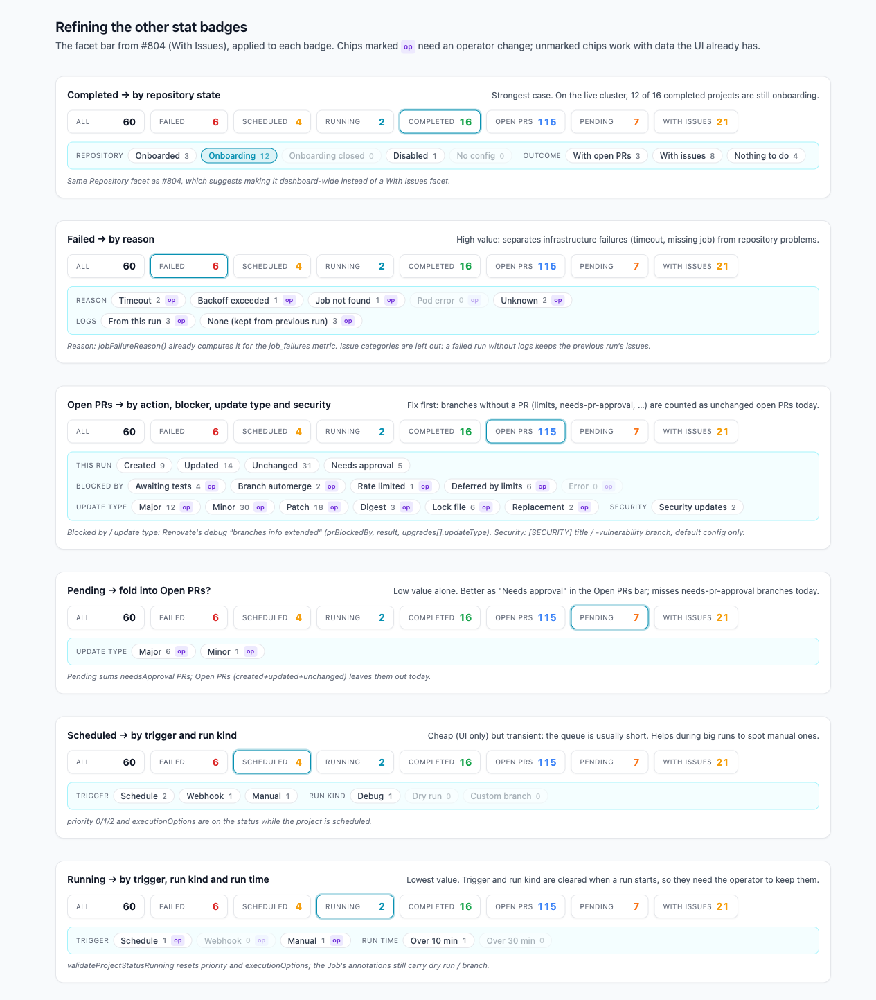
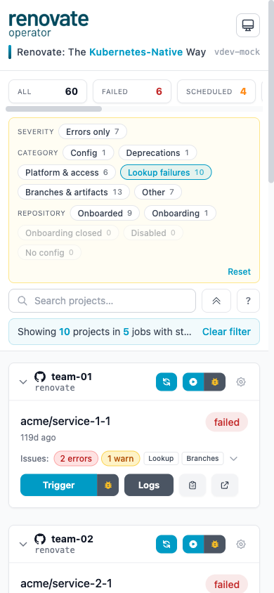

# Design: refining every stat badge, not only "With Issues"

Status: research and plan. Nothing here is implemented beyond **With Issues** (#804, PR #809).
Checked against `main` at 6.10.0 + `fe715da` and Renovate **43.104.1**.

#809 lets the user narrow **With Issues** by severity, category and repository state. This
document checks whether the same pattern helps on the other stat badges. For each badge it asks
what data could narrow it, and whether the UI already has that data or the operator would need
to store it. It ends with a phased plan.



Chips marked **op** need an operator change; unmarked chips work with data the UI already has.
In the mockup, only the Completed panel's Repository numbers come from a live cluster
(16 projects); all other numbers are illustrative.

---

## 1. Summary

| Badge | Refine by | Data today? | Value | Blocker / caveat |
|---|---|---|---|---|
| **Completed** | Repository state; outcome | yes | **high**: on a live cluster, 12 of 16 completed projects were only onboarding | none |
| **Failed** | Failure reason | no: computed for a metric, not stored | **high** | a failed run without logs keeps the *previous* run's issues and result |
| **Open PRs** | This run; blocked by; update type; security | action: yes. Blocked by and update type: in Renovate's debug log, not stored. Security: heuristic | medium–high | **counts branches without a PR as open PRs** (§4.3) |
| **Pending** | fold into Open PRs | yes | low alone | misses `needs-pr-approval` branches (§4.3) |
| **Scheduled** | Trigger; run kind | yes, while queued | low–medium | transient |
| **Running** | Run time; trigger and run kind | run time: yes. Trigger and run kind: cleared when the run starts | low | operator change for trigger and run kind |
| **With Issues** (#809) | + Abandoned dependencies | yes, since 6.10.0 | medium | abandoned-only projects are not "With Issues" today (§4.7) |
| (Cancelled) | no badge exists | — | — | only reachable through **All** |

Cross-cutting conclusions (§5):
1. Repository state is a **dashboard-wide** filter.
2. Build one generic facet bar, with a **collapsed form on small screens**.
3. Chips count projects, everywhere.
4. Every refinement also narrows **Trigger N**, which has no confirmation step.
5. **None of the new dimensions reach the metrics yet** (§10). Each phase should export its
   dimension as a bounded label, so Grafana panels and alerts can use the same cuts as the
   dashboard.

---

## 2. How the badges work today

`src/static/index.html`, `projectMatchesStatFilter` and `calculateStats`:

| Badge | Selects projects where | Counter counts |
|---|---|---|
| All | (no filter) | projects |
| Failed / Scheduled / Running / Completed | `status` equals the badge | projects |
| Open PRs | `created + updated + unchanged > 0` | **PRs** (sum), not projects |
| Pending | `needsApproval > 0` | **PRs** (sum), not projects |
| With Issues | `warnCount + errorCount > 0` | projects |

- Each card's **Hide Projects** menu (`STATUS_FILTERS`) also *hides* the following, **per card**,
  stored in `localStorage` rather than the URL:
  - Onboarding Closed / Disabled / No Config
  - projects without PRs
  - projects without issues
- A card's **Trigger N** button triggers exactly the rows on screen (#626), so every refinement
  narrows the bulk trigger too. There's no confirmation step; the count on the button is the
  only cue.
- The dashboard polls `/api/v1/renovatejobs` every 30 s. The payload embeds the full
  `RenovateProjectState`, so new status fields reach the UI without API work.
- URL parameters in use: `filter`, `search`, and, from #809, `issues`, `severity`, `repo`.
- The stat badges sit in a **sticky** toolbar that is deliberately one scrollable row: "the toolbar
  has to stay short enough that it does not eat the viewport it is pinned to". Since 6.10.0,
  badges keep their width on mobile.

---

## 3. Data per project and where it comes from

`RenovateProjectState` (`src/api/v1alpha1/renovateproject_types.go`):

| Field | Content | Lifetime |
|---|---|---|
| `status` | scheduled, running, completed, failed, cancelled | always |
| `renovateResultStatus` | done, Onboarding, Onboarding Closed, Disabled, No Config, Unknown, or a raw result (e.g. `repository-changed`) | last run that produced logs |
| `prActivity` | counts per action, plus up to 100 `prs` (branch, number, title, action) | same; **needs debug logging** |
| `logIssues` | warn/error counts, `categoryCounts` (#804), up to 20 messages; `abandonedCount` and up to 50 `abandonedDependencies` (6.10.0; nil = unknown without debug logging) | same |
| `priority` | max of: 0 schedule / discovery / `kubectl annotate`, 1 webhook, 2 UI trigger | **only while scheduled**: reset when the run starts (`validateProjectStatusRunning`) |
| `executionOptions` | debug, dryRun, baseBranch | **only while scheduled** |
| `lastTransition`, `duration` | when the state changed, and the last run's length | always |

Status merging (`src/internal/utils/projectStatus.go`) only overwrites result, PR activity and
issues when the new value is non-nil. If a run yields no logs (the Job wasn't found, or the logs
couldn't be read), the project keeps the **previous run's** values, even when this run failed.

### What the operator knows but does not store
- **Failure reason:** `jobFailureReason()` (`src/internal/renovate/jobHelper.go`) maps the
  Job's `JobFailed` condition:
  - `DeadlineExceeded` → timeout
  - `BackoffLimitExceeded` → backoff_exceeded
  - `PodFailurePolicy` → pod_error
  - no Job → job_not_found
  - anything else → unknown

  It only feeds `renovate_operator_job_failures_total`.
- **Per-branch detail.** Renovate's debug message `branches info extended`
  (`workers/repository/finalize/repository-statistics.js`) logs, per branch:
  - `branchName`, `prNo`, `prTitle`, `result`, `prBlockedBy`
  - `upgrades[]`, each with: `datasource`, `depName`, `displayPending`, `fixedVersion`,
    `currentVersion`, `currentValue`, `currentDigest`, `newValue`, `newVersion`, `newDigest`,
    `packageFile`, `updateType`, `packageName`

  The parser reads only `branchName`, `prNo`, `prTitle` and `result`.

### Renovate value sets (43.104.1)
| Field | Values |
|---|---|
| `updateType` | major, minor, patch, pin, digest, pinDigest, lockFileMaintenance, lockfileUpdate, rollback, bump, replacement |
| `prBlockedBy` | AwaitingTests, BranchAutomerge, NeedsApproval, RateLimited, Error |
| `result` | already-existed, automerged, done, error, needs-approval, needs-pr-approval, not-scheduled, no-work, pending, pr-created, pr-edited, pr-limit-reached, commit-per-run-limit-reached, commit-hourly-limit-reached, branch-limit-reached, rebase, update-not-scheduled, minimum-group-size-not-met |

### Security updates
`isVulnerabilityAlert` is **not** in `branches info extended`; the field list above is exhaustive.
Renovate's `vulnerabilityAlerts` defaults mark these PRs instead:
- the PR title gets the suffix `[SECURITY]`
- the branch name ends in `-vulnerability`

The parser already stores both, so a heuristic works today. A repository that overrides those
defaults isn't detected.

---

## 4. Findings per badge

### 4.1 Completed: strongest case
- On a live cluster: **Completed 16 = onboarding 12 + done 3 + disabled 1**. "Completed" means the
  Job finished, not that Renovate manages the repository.
- Facets:
  - **Repository** (`renovateResultStatus`), as in #809.
  - **Outcome**: with open PRs / with issues / nothing to do. This overlaps the card menu's "hide
    without PRs / without issues".
- No operator change needed.

### 4.2 Failed: needs one stored field
- "Failed" mixes infrastructure failures (Job deadline, Job deleted, pod crash loop), which belong
  to the platform team, with runs Renovate aborted, which belong to the repository owner.
- **Reason** facet needs a `failureReason` status field:
  - Set from `jobFailureReason()` where the executor sets `failed`.
  - Cleared when the next run starts.
- Issue categories are **unreliable** on Failed: a failed run without logs keeps the previous
  run's issues. A `logsParsed` flag (the data is from this run) would make that visible.
- OOM kills appear as backoff_exceeded or pod_error. Telling them apart needs the pod's
  `terminated.reason`, which the operator doesn't read.

### 4.3 Open PRs and Pending: fix the counts first
- **Parser bug:** `isActiveBranchResult` treats unlisted results as active, and
  `branchResultToAction` maps them to `unchanged`. A branch **without a PR** whose result is one
  of the following is counted as an *unchanged open PR*:
  - pr-limit-reached, branch-limit-reached
  - commit-hourly-limit-reached, commit-per-run-limit-reached
  - needs-pr-approval
  - minimum-group-size-not-met
  - update-not-scheduled
  - rebase
  - done

  Verified for each value with a throwaway unit test. `needs-pr-approval` (PR creation waiting
  for approval on the dashboard) never reaches **Pending**.
- Facets once that's fixed:
  - **This run**: created / updated / unchanged / needs approval, from existing data.
  - **Blocked by**, from `prBlockedBy`: awaiting tests, branch automerge, rate limited, error.
    Plus **Deferred by limits** for the `*-limit-reached` results, which a platform team tunes
    via `prConcurrentLimit`, `branchConcurrentLimit` and `prHourlyLimit`.
  - **Update type**, from `upgrades[].updateType`. A branch can group several upgrades, so
    store a set, or the highest one.
  - **Security**, from the title or branch heuristic. It works today; label it as
    default-config only.
- Inherited limits: needs debug logging; capped at 100 PRs per project.
- **Onboarding PRs are not counted as open PRs**, confirmed in code:
  - The parser doesn't match `Onboarding PR created/updated`.
  - The onboarding code never adds a `branch` field to its log context, so its
    `… does not need updating` line is dropped too.

  The fixture `onboarding-open` (a created "Configure Renovate" PR) therefore shows a state the
  operator never produces.
- **Pending** is a small population. It's better as "Needs approval" in the Open PRs bar.

### 4.4 Scheduled: cheap, transient
- Facets:
  - **Trigger**: Schedule (0: cron, discovery follow-up, `kubectl annotate`), Webhook (1),
    Manual (2: UI single or Trigger all). Priorities are max-merged.
  - **Run kind**: debug / dry run / custom branch.
- No operator change.

### 4.5 Running: lowest value
- Trigger and run kind are cleared when the run starts. Two ways to keep them:
  - Clear them on completion instead. This changes the debug button's "Queued: …" label from #685.
  - Read the Job's annotations (`DryRunAnnotationKey`, `BaseBranchAnnotationKey`; there's no
    trigger annotation).
- **Run time** (from `lastTransition`) works today.

### 4.6 Cancelled
- It's a status without a badge; it only shows under **All**.

### 4.7 With Issues and abandoned dependencies (new in 6.10.0)
- Since 6.10.0 the Issues column shows an "N abandoned" badge (`logIssues.abandonedCount`, parsed
  from Renovate's debug line `Abandoned package statistics`).
- `projectHasIssues` still checks only warnings and errors. A project whose only finding is
  abandoned dependencies shows an issue badge on its row, but **With Issues doesn't select it**.
- Options:
  - Count `abandonedCount > 0` as an issue and add a **Dependencies: Abandoned** facet to the
    With Issues bar.
  - Or keep abandoned dependencies out of With Issues on purpose and say so in the badge
    tooltip.

  Either way, `abandonedCount: nil` (no debug logging) must read as "unknown", not zero.

---

## 5. Cross-cutting design

1. **Global Repository filter.** Repository state matters for Completed, With Issues, Open PRs
   and Failed, and it overlaps the card menu's 3 status checkboxes. Make it a dashboard-wide
   control combinable with any badge, kept in `repo=` (already used by #809). Users with stored
   `hiddenStatuses:*` keys need a migration: honour or drop them.
2. **Generic facet bar.**
   - Generalise `IssueRefinementBar` into `RefinementBar({ facets, projects, refinement, onChange })`.
   - A facet is `{ key, label, urlParam, values: [{ key, label, hint }], match(project, selected), unavailable?(projects) }`.
   - Each badge declares its facets. The "chip counts what it would leave" logic is already
     generic.
3. **Small screens.** At 390 px the With Issues bar alone takes about 230 px of the sticky toolbar:

   

   Below the `sm` breakpoint the bar should collapse into a "Refine (n)" disclosure, so the
   toolbar stays one row.
4. **URL scheme.** One parameter per facet, read only for the selected badge:
   - `issues`, `severity`, `abandoned` (With Issues)
   - `reason` (Failed)
   - `action`, `blocked`, `update`, `security` (Open PRs)
   - `trigger`, `kind` (Scheduled)
   - `repo` (global)

   Unknown values are dropped, as in #809.
5. **Counting unit.** Chips count projects. PR badges keep counting PRs, and their tooltip says so.
6. **Missing data is shown as missing, not as zero.** This covers:
   - PR facets without debug logging
   - `abandonedCount: nil`
   - categories from statuses written before #804
   - failed runs without logs
7. **Bulk trigger.** The Trigger N button or its tooltip names the active refinement.
8. **Caching.** Since 6.10.0 the vendored libraries get a `?v=<version>` query; component files
   such as `components/IssueRefinement.js` don't. A phase that rewrites a component should check
   that browsers pick up the new file after an upgrade.
9. **Performance.** Chip counts are facets × values × projects per render. Memoise per poll if
   installs reach thousands of projects.

---

## 6. Operator changes needed

| Change | Where | For | Size |
|---|---|---|---|
| Don't count branches without a PR as open PRs; map `needs-pr-approval` to needs approval | `parser/logParser.go` (`isActiveBranchResult`, `branchResultToAction`) | Open PRs, Pending | small, **bug fix** |
| `failureReason` | `api` types, `executor.ProcessProjectJobResult`, `projectStatus.go` | Failed | small + CRD |
| `logsParsed` flag | executor, status merge | Failed, every "last run" field | small + CRD |
| `PRDetail.blockedBy`, `PRDetail.result` | parser `branchSummaryItem`, `api.PRDetail` | Open PRs | small + CRD |
| `PRDetail.updateTypes` | parser reads `upgrades[].updateType` | Open PRs | small–medium + CRD |
| Keep trigger/run kind while running | `validateProjectStatusRunning` or Job annotations | Running | small; touches #685 |
| OOM detection | `jobFailureReason` + pod lookup | Failed | medium |

All new fields are optional (`omitempty`), so older statuses keep decoding, as tested for #804.
None touch policy, auth or secrets.

---

## 7. Plan

| Phase | Scope | Operator | UI | Metrics (§10) | Depends on |
|---|---|---|---|---|---|
| **0** | Bug: branches without a PR counted as open PRs; `needs-pr-approval` not pending; fix the `onboarding-open` fixture | parser | fixtures | corrects `open_pull_requests` and `approvals_needed` | — |
| **1** | Generic `RefinementBar`; #809's facets moved onto it; global Repository filter; collapsed bar on small screens; abandoned dependencies in With Issues (§4.7) | — | yes | `log_issues_by_category`, `project_result_status` | #809 |
| **2** | Completed: Outcome facet | — | yes | none new (joins on phase 1) | 1 |
| **3** | Failed: `failureReason` + `logsParsed`, then the Reason facet | yes | yes | `run_failure_reason`, `last_run_logs_parsed` | 1 |
| **4** | Open PRs: This run + Security, then `blockedBy`/`result` and `updateTypes`; Pending folded in | yes | yes | `open_pull_requests_by_update_type`, `open_pull_requests_blocked`, `security_pull_requests` | 0, 1 |
| **5** | Scheduled: Trigger + Run kind | — | yes | `trigger` label on `jobs_dispatched_total` | 1 |
| **6** | Running: Run time; trigger and run kind only if wanted | optional | yes | none (kube-state-metrics covers job age) | 1 |

Each phase is one issue and one PR, with implementation and test commits separate:
- Go changes are unit-tested.
- Each badge gets a Playwright spec, plus fixture variants for every new value.
- User docs go in `docs/operations/pr-activity.md`.
- Metric reference and example alerts go in `docs/operations/metrics.md`.

## 8. Decisions for maintainers

1. Global Repository filter, and drop the card menu's status checkboxes?
2. Acceptable CRD growth: `failureReason`, `logsParsed`, `PRDetail.*`?
3. Pending: keep the badge, or fold it into Open PRs?
4. Should Open PRs count `needs-approval` PRs?
5. Show the security heuristic, given it misses customised configs?
6. Should **With Issues** count abandoned dependencies?
7. Metrics: a new metric per dimension (recommended, §10.3), or new labels on existing metrics
   (breaks existing queries)? Should `repositories_by_status` get a `done` value instead of
   lumping onboarded repositories into `other`?

## 9. Remaining unknowns

- How common `*-limit-reached` and `needs-pr-approval` are in practice. A debug run on a
  repository at its `prConcurrentLimit` would show it.
- Whether `fixedVersion` in `branches info extended` is set only for vulnerability fixes, which
  would give a non-heuristic security signal.

---

## 10. Metrics

### 10.1 What is exported today

Labels: `renovate_namespace`, `renovate_job`, `project`. Per-project gauges describe the last
real run; dry runs are skipped.

| Dimension in the UI | Metric today | Granularity | Gap |
|---|---|---|---|
| Failed | `run_failed` (0/1), `project_executions_total{status}` | project | none |
| Failure reason | `job_failures_total{kind, reason}` | **job only** (counter) | not per project |
| With Issues | `dependency_issues` (0/1), `log_issues{level}` | project | none |
| Severity | `log_issues{level="warn"\|"error"}` | project | none |
| Issue category (#804) | — | — | **missing** |
| Abandoned dependencies | `abandoned_dependencies` | project | none; nil (no debug) deletes the series |
| Config migration | `config_migration_needed` | project | none; not on the shipped dashboard |
| Repository state | `repositories_by_status{status}` | **job only**; `done` is reported as `other` | not per project, so it can't be joined with issues |
| Open PRs / Pending | `open_pull_requests`, `approvals_needed` | project | **inflated by the §4.3 bug**, like the UI |
| PR action / blocked by / update type / security | `pull_requests_{created,updated,merged}_total` | job only (counters) | blocked by, update type and security **missing** |
| Scheduled / Running | `projects_scheduled`, `projects_running`, `project_queue_wait_seconds` | job | trigger source **missing** |
| Run time | `job_duration_seconds`, `last_execution_duration_seconds` | job / project | age of a *running* job: use kube-state-metrics (`kube_job_status_start_time`) |

The Helm chart ships a Grafana dashboard (`charts/renovate-operator/templates/dashboard.yaml`).
It uses `dependency_issues`, `log_issues`, `run_failed`, `open_pull_requests` and
`repositories_by_status`, but not `abandoned_dependencies` or `config_migration_needed`.
`docs/operations/metrics.md` has example alerts for failed runs, dependency issues, duration,
stalled automerge and others.

### 10.2 Consequences

- Nothing the new facets add can be graphed or alerted on yet: categories, per-project failure
  reason, per-project repository state, update type, blockers and trigger.
- The §4.3 bug inflates `open_pull_requests` too, and with it the shipped dashboard's PR panels
  and the documented `RenovateAutomergeStalled` alert. Phase 0 fixes the metric as well.
- After a restart, per-project gauges are rebuilt from the CRD status (`RehydrateMetrics`). A
  failed run without logs keeps the previous run's values there too, so the `logsParsed` flag
  (§4.2) matters for metrics as much as for the UI.

### 10.3 Proposed metrics

The rule, as for `abandoned_dependencies`: **bounded labels only**. That means no package names,
messages or branch names. New dimensions go into **new metrics**, not new labels on existing ones:
adding a label to `log_issues` would split its series and break every query that relies on one
series per project and level.

| Metric (gauge unless noted) | Labels beyond namespace/job/project | Values | Series | Phase |
|---|---|---|---|---|
| `renovate_operator_log_issues_by_category` | `category` | config, deprecation, platform, lookup, branches, other | ≤ 6 × projects | 1 (or #809) |
| `renovate_operator_project_result_status` (info, value 1) | `status` | done, onboarding, onboarding_closed, disabled, no_config, unknown, other | 1 × projects | 1 |
| `renovate_operator_run_failure_reason` (info, value 1; deleted on success) | `reason` | timeout, backoff_exceeded, pod_error, job_not_found, unknown | ≤ 1 × projects | 3 |
| `renovate_operator_last_run_logs_parsed` | — | 0/1 | 1 × projects | 3 |
| `renovate_operator_open_pull_requests_by_update_type` | `update_type` | major, minor, patch, digest, pin, lockFileMaintenance, replacement, rollback, other | ≤ 9 × projects | 4 |
| `renovate_operator_open_pull_requests_blocked` | `blocked_by` | awaiting_tests, branch_automerge, needs_approval, rate_limited, error, limits | ≤ 6 × projects | 4 |
| `renovate_operator_security_pull_requests` | — | count (heuristic, §3) | 1 × projects | 4 |
| `renovate_operator_jobs_dispatched_total` (existing counter) | + `trigger` | schedule, webhook, manual | ×3 per job | 5 |

At 1,000 projects the per-project additions come to at most about 30,000 series, and in practice
far fewer, since zero-valued category and type series can be deleted rather than kept.
`jobs_dispatched_total` is per job, so adding a label there is cheap, but it does change existing
series. Alternatively, add a new `executor_runs_by_trigger_total`.

Every new per-project metric needs the same four touch points as today's:
1. a setter in `executor.ProcessProjectJobResult`
2. a restore in `RehydrateMetrics`
3. a cleanup in `DeleteProjectMetrics`, using `DeletePartialMatch` for the multi-value ones
4. an entry in `docs/operations/metrics.md`

Info-style metrics also need the old series deleted when the value changes. OpenTelemetry export
(`addOtel`) only exists for counters today, so these gauges stay Prometheus-only, like the rest.

### 10.4 Alerts and panels this enables

```yaml
# A repository's own Renovate config is broken, on repositories Renovate actually manages
- alert: RenovateConfigProblems
  expr: |
    renovate_operator_log_issues_by_category{category="config"} > 0
    and on (renovate_namespace, renovate_job, project)
    renovate_operator_project_result_status{status="done"} == 1

# Platform access broke for a whole job (expired token, missing permission): many repos at once
- alert: RenovatePlatformAccessErrors
  expr: count by (renovate_namespace, renovate_job) (renovate_operator_log_issues_by_category{category="platform"} > 0) >= 3

# Infrastructure, not repositories: runs hitting the Job deadline (works today, per job)
- alert: RenovateRunsTimingOut
  expr: increase(renovate_operator_job_failures_total{reason="timeout"}[6h]) > 0

# Renovate holds updates back because of PR/branch limits: the platform team should tune them
- alert: RenovateUpdatesDeferredByLimits
  expr: sum by (renovate_namespace, renovate_job) (renovate_operator_open_pull_requests_blocked{blocked_by="limits"}) > 0

# Security updates waiting
- alert: RenovateSecurityUpdatesOpen
  expr: renovate_operator_security_pull_requests > 0
  for: 3d
```

Dashboard panels follow the same cuts:
- issues by category (stacked, per job)
- repository coverage per job, using `done` instead of `other`
- failures by reason
- open PRs by update type
- runs by trigger

### 10.5 Gaps metrics cannot close

- PR **age** (open for N days) isn't known to the operator. `for:` on an alert approximates it.
- Run age while **running** is better taken from kube-state-metrics than duplicated.
- The security count depends on Renovate's default naming (§3).

